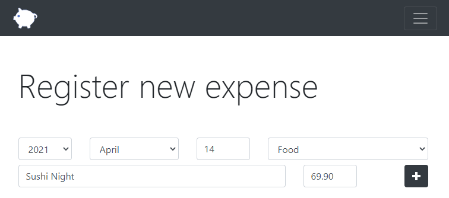
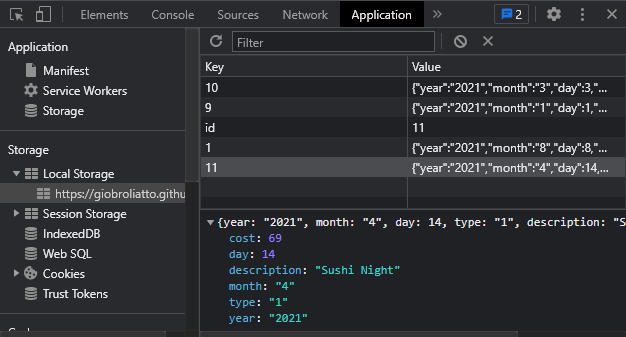
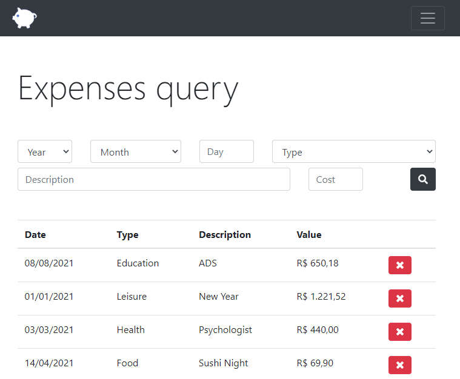

# Personal Budget

**Expense tracker that runs entirely in the browser, with validation, filters and storage in `localStorage`.**

**[See it live](https://giobroliatto.github.io/personal-budget/)**

**English** · [Português](README.pt-BR.md)

> [!NOTE]
> Built in 2021 while following a full-stack web developer course. It was my first system written with object-oriented programming.

---

## About

You record expenses with date, type, description and amount, then look them up later with filters. Everything is stored in the browser's own storage, so no server is needed.

## Features

- **New expense** with year, month, day, type, description and amount.
- **Validation:** empty fields, invalid dates (including day limits per month and leap years) and non-numeric amounts are rejected.
- **Query with filters** on any field (day, month, year, type, description and amount).
- **Deletion** with a confirmation prompt.

## Technical highlights

- **Object-oriented:** an `Expense` class with its own validation, and a `Db` class that wraps `localStorage` (record, list, search and remove), with an incrementing ID.
- **Bootstrap** for layout and modals, with no build step.

## Running locally

No build step: clone the repository and open `index.html` in your browser.

---

## Author

Made by **Giovani Broliatto**.

